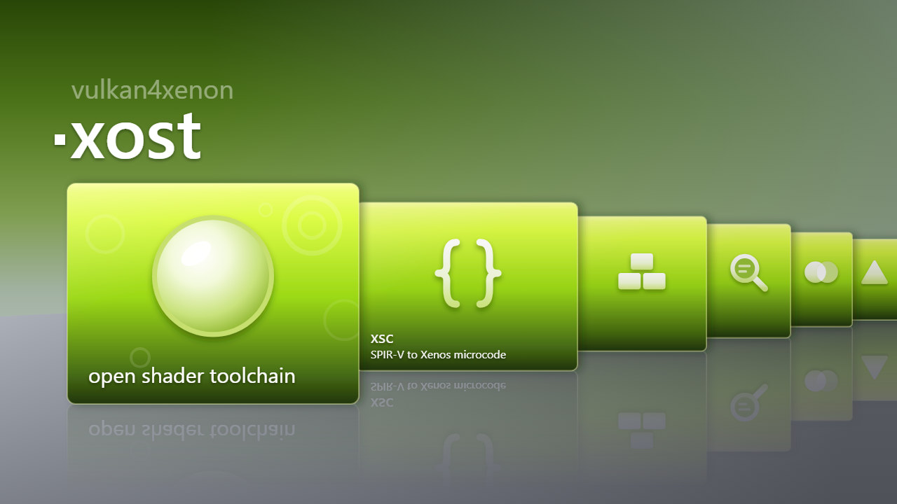

<div align="center">
  
</div>

# xost, the Xenos shader toolchain

xost compiles shaders for the Xbox 360's GPU, Xenos, with no Microsoft tooling: GLSL through glslang to SPIR-V, then
SPIR-V to a Xenos shader container, every byte from open code. It's part of xsdk. The SDK's own generators, its
tests' shaders, vulkan4xenon's shaders and Dusklight's shader pack are built with it, and the SDK's titles run them on
the console.

## What's here

- **`xsc/`, the compiler.** Vulkan and OpenGL SPIR-V to a Xenos container. It's C, in xsdk's `src/xsc_*.c`
  (`include/xsdk/xsc.h`), so titles compile shaders on the console with it; on the PC, make builds it as
  `build/host/libxsc.so` in WSL, and `lower.py` and `resolve.py` call it through `native.py` as the Python compiler
  was called. `spirv.py` reads SPIR-V for the tests, and `templates.py` holds the instruction templates the hand-built
  shaders start from, from Xenia's definitions. What the compiler handles and refuses is in
  [`docs/xsc.md`](docs/xsc.md).
- **`xasm/`, the assembler** for shaders built by hand. The instruction encoders (`encode.py`), the program builder
  (`program.py`: execs, register packing, container metadata), the text assembler (`textasm.py`,
  [`docs/textasm.md`](docs/textasm.md)) and an N64 colour-combiner compiler (`combiner.py`).
- **`xdis/`, the disassembler and simulator.** The microcode decoder, its ISA tables transcribed from Xenia (BSD-3,
  see `xdis/xenos_ucode.py`), the container parser and emitter ([`docs/container.md`](docs/container.md)), and
  `simulate.py`, which runs a program's ALU, fetches and exports on the CPU.
- **`xcomb/`, the combiner compiler in C99**, byte for byte the same as `xasm/combiner.py`.
- **`tests/`**, run one file at a time in WSL: `python3 tests/test_xsc_lower.py`. `tests/test_xcomb_parity.py` builds
  `xcomb/` with MSVC and runs on Windows.

## Use

On the PC: WSL with Python 3.11 or later, standard library only, and xsdk built there (`make` in its root builds the
compiler's library). glslang goes in `tools/glslang` and the reference clones the docs cite, Xenia, libxenon,
XenosRecomp and mupen64-360, in `reference/`; neither is tracked. The Windows glslang and XenosRecomp run from WSL.

```sh
# Lower a SPIR-V module to a container, laid out for xsdk's register split
python3 -m xsc.lower shader.spv -o shader.bin --pixel-registers 64 --vertex-registers 64 --optimize

# Disassemble a container; --exact gives text that reassembles byte for byte
python3 xdis/xdis.py shader.bin
```

vulkan4xenon's `tools/build_shaders.py` and Aurora's `tools/build_glsl_pack.py` take this folder as `--xost`.

## History

xost was a repository of its own until 2026-10-14, when it joined xsdk:
[github.com/xenosworks/xenos-toolchain](https://github.com/xenosworks/xenos-toolchain), last commit `4a785c6`. xsdk's
docs cite xost's commits by that repository's hashes. It keeps what didn't come over:

- the test vectors the first decoders and templates were checked against, shaders compiled with Microsoft's compiler
  that xsdk doesn't carry, and the tests and examples built on them;
- the libxenon demo apps and their built binaries;
- the plans and notes from xost's time as a project of its own.
